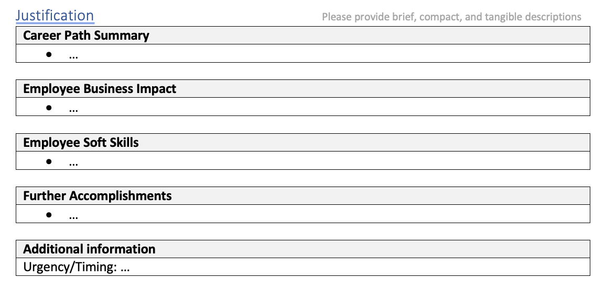

### 13.10.2026:
	- Agenda prep:
		- Nicht leicht einen Termin zu kriegen :D ? keine Konflikte?
		- Situation mit Wille - sucks^^
		- Gut das ich stress resistent bin
		- Holzklopf^^
		- Muss etwas carry-en
		- Geh normal ned Gehalt fordern, des würde alles erledigen
		- Nach lebenslangem Enthusiasmus, Ausgezeichneten Master-abschluss ... mittlerweile seit 12.5 Jahren Enterprise Softwareentwicklung
		- Bin absolut qualifiziert. Viellecht noch nicht mit 100% domain knowledge drinnen
		- 3y zu lange, in 1 jahr bin ich experte
		- Wenn ich's krieg - 5y beweisen dass verdient mit 120%
		- Wenn nicht - 3y silent mit 115%, kündige deswegen nicht
		- Aber bisschen den Backendentwickler Mangel ausnützten
		- Wenn's für dich passt, würde ich gerne probieren, mehr als Ablehnung kann ich nicht kriegen
	- Talk
		- 
		- Need Quotes from e.g. Christian, Lukas, Rene himself,...
		- qote. <150 words, where did i act on senior II level already, describing situations matters
		- Carreer path: Linked in link would be enough
		- Most important: Impact - brag doc
		- Based on what Rene heard about me, possible - but likely not until June
		- Further Accomplishments: CI handling, topo GA, cross-communications,...
		- Add P4/L17 in the Brag document lines, then let claude cosume it and write it well
		- Urgency/Timing: he would set "now" here. "Retention" is an option
		- Request might be then approved/deferred, then we have no more control over it.
		- Since vl 17: elligible for bonus: performance based - up to 10% extra
		- Stocks 40-50k für p4, 15-25k für p3
		- Important is also: am I an VI / Epic drivers
		- Impact: create ADRs, Design decisions, Dependencies, communication
		- P4: = P3 (softwreaentw. onboarding, team-level impact) + P4 (outside team, inter-cap impact, stakeholder, default with topo engine anyway)
		- P5 woudl be: outside cap impact
-
-